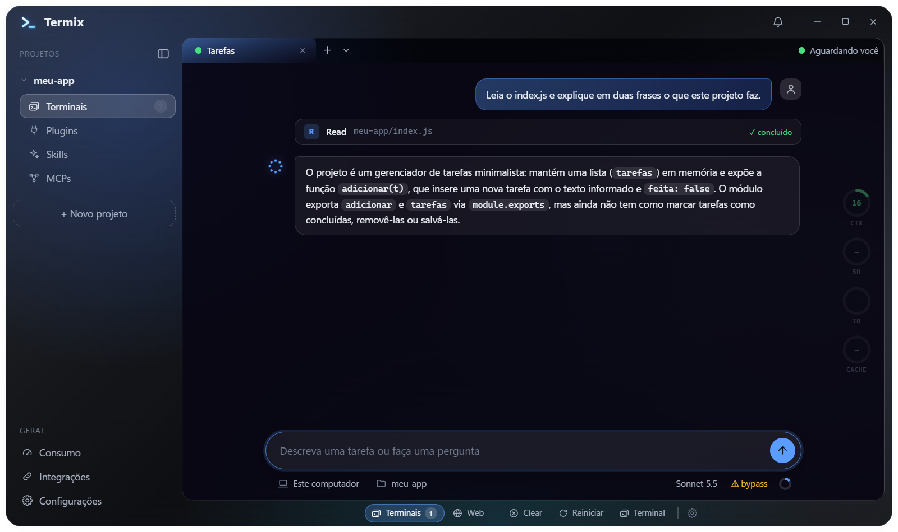

# Termix

Uma janela só para todas as suas conversas com o **Claude Code**. O Termix organiza projetos e abas, deixa cada aba como **Chat** (bolhas) ou como **Terminal**, retoma as conversas pelo ID e mostra, ao lado, o quanto da sessão e da conta você já usou.



> App desktop para **Windows**, feito em Electron, com visual em vidro (glassmorphism). Ainda é um projeto jovem: a versão atual é a 0.1.x.

## O que ele faz

- **Projetos e abas.** Crie um projeto novo ou importe uma pasta que já existe (o Termix lista as conversas do Claude Code que estavam nela e abre só as que você marcar). Cada projeto tem quantas abas quiser, com nome e cor próprios, que você pode arrastar para reordenar.
- **Chat ou Terminal, na mesma conversa.** A aba de Chat mostra a conversa em bolhas, com Markdown, código com botão de copiar, as ferramentas em cartões, imagens coladas e o menu `/` com as suas skills e comandos. A aba de Terminal é o Claude Code de sempre. Uma aba troca de um modo para o outro sem perder a conversa.
- **Retomada confiável.** Reiniciar uma aba volta na conversa exata, pelo ID. Ao reabrir o app, as abas que estavam abertas voltam sozinhas.
- **Consumo à vista.** Anéis ao lado da conversa mostram o contexto usado, os limites de 5 horas e de 7 dias da sua conta e o tempo que falta para o cache do prompt esfriar. Os dados vêm da status line do Claude Code; quando um dado não está disponível, o Termix escreve "indisponível" em vez de inventar um número.
- **Plugins, Skills e MCPs.** Veja o que o Claude Code enxerga em cada projeto e ligue, desligue, instale, crie ou remova pela tela. As mudanças passam pela própria CLI do Claude Code, então o que você faz pelo terminal continua aparecendo no app.
- **Navegador embutido.** Uma aba Web por projeto para ver e testar o que você está construindo, sem sair da janela.
- **Avisos que ajudam.** O Termix avisa quando um agente termina, quando precisa de você, quando dá erro e quando o cache está para esfriar. Enquanto o agente trabalha, não incomoda.
- **Atualização com um clique.** Quando sai uma versão nova, um aviso aparece no cabeçalho.

## Instalação

**O que você precisa antes**

- Windows 11 (é onde o Termix é testado; o Windows 10 deve funcionar, mas não foi testado).
- O **Claude Code** instalado e com a sua conta conectada. O Termix **não instala** o Claude Code: se ele não for encontrado, a aba mostra como resolver.

> Guia completo para o time, com a checagem do Smart App Control e o que fazer se o Windows bloquear: **[docs/INSTALACAO.md](docs/INSTALACAO.md)**.

**Passo a passo**

1. Abra a página de [Releases](https://github.com/rocruzta50IND/termix/releases/latest) e baixe `Termix-Setup-<versão>.exe`.
2. Execute o instalador. Ele instala só para o seu usuário (não pede administrador) e cria atalhos na área de trabalho e no menu Iniciar.
3. Como o instalador ainda **não é assinado digitalmente**, o Windows SmartScreen pode mostrar "O Windows protegeu o computador". Clique em **Mais informações** e depois em **Executar assim mesmo**.
4. Abra o Termix, clique em **+ Novo projeto** (ou importe uma pasta) e comece a conversar.

**Atualizar.** Com o Termix instalado, ele mesmo consulta se há versão nova e avisa no cabeçalho. Clique em **Atualizar agora** (ou em **Depois**, e o botão **Atualizar** fica no cabeçalho). O app reinicia e as abas voltam sozinhas.

**Desinstalar.** Pelo "Aplicativos instalados" do Windows. Seus projetos, abas e configurações ficam guardados em `%APPDATA%\Termix` e **não** são apagados; as conversas em si são do Claude Code.

## Primeiros passos

- O botão **+** da barra de abas cria uma aba no modo escolhido em **Configurações > Chat** (Chat é o padrão); o menu ao lado do **+** tem os dois modos.
- No rodapé, **Clear** (um clique em Confirmar) limpa o contexto na hora e já entrega ao agente um resumo do ponto em que vocês estavam, sem ele reler o projeto (o resumo é montado pelo app, sem gastar o Claude), **Reiniciar** reinicia o processo mantendo a conversa e o botão **Terminal/Chat** abre a mesma aba no outro modo.
- No chat, digite `/` no começo da mensagem para escolher uma skill ou comando, e cole ou arraste imagens para a caixa.
- Para o Claude executar sem pedir permissão, use as abas em **Automático**; para aceitar edições de arquivo e perguntar o resto na conversa, **Perguntar** (em Configurações > Chat). No terminal, a opção **Dangerously** ignora as verificações de permissão e não tem isolamento do sistema: use com cuidado.

## Limites conhecidos

- O instalador não é assinado, então o SmartScreen avisa (veja acima).
- Só Windows por enquanto; o Windows 10 não foi testado.
- O Codex e outras ferramentas de agente aparecem como "Em breve".
- No navegador embutido, o login com Google não funciona (o Google bloqueia); entre por GitHub ou e-mail e senha.
- No chat em modo **Perguntar**, o que não é edição de arquivo aparece na conversa como um cartão: **Permitir uma vez**, **Permitir sempre neste projeto** (grava a regra em `.claude/settings.local.json` do projeto) ou **Negar**.
- Os limites de 5 horas e de 7 dias, e o cache, chegam pela status line do Claude Code: em um projeto que só tem abas de chat esses anéis ficam sem dado (eles vêm das abas de terminal).
- Várias abas na mesma pasta não têm proteção contra edições simultâneas.

## Problemas e sugestões

Abra uma [issue](https://github.com/rocruzta50IND/termix/issues) dizendo o que aconteceu, a versão do Termix (a do instalador) e, se puder, uma captura da janela. Não cole chaves, senhas nem conteúdo privado das suas conversas.

## Para quem quer mexer no código

```
npm install
npm start        # abre o app em desenvolvimento
npm run check    # checagem de sintaxe dos arquivos JavaScript
npm run dist     # gera o instalador em dist\Termix-Setup-<versão>.exe
```

- `src/main.js` (processo principal: janela, PTYs, estado), `src/chat.js` (processo do chat), `src/preload.js` (ponte), `src/renderer/` (interface) e `src/statusline-wrapper.js` (captura dos limites).
- Decisões de produto em [`docs/DECISOES.md`](docs/DECISOES.md); aparência em [`docs/DESIGN.md`](docs/DESIGN.md); histórico em [`docs/CHANGELOG_DEV.md`](docs/CHANGELOG_DEV.md).
- O projeto segue o fluxo de desenvolvimento descrito em [`WORKFLOW.md`](WORKFLOW.md).
