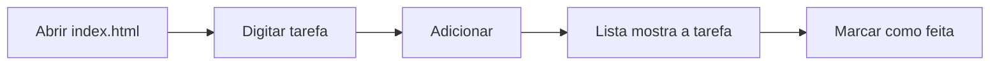

# Validação do MVP do Vibe Coding e do Mutirão — roteiro para o Ygor

Roteiro para testar o Vibe Coding e o Mutirão **no seu Termix de verdade**, rodando a partir da branch `dev2`. Marque cada caixa `[x]` à medida que for passando e anote o que estranhar. No fim (seção 7) há um modelo do veredito para mandar ao orquestrador.

- **Roteiro A (Vibe Coding):** o principal. Cerca de 30 a 60 minutos.
- **Roteiro B (Mutirão):** opcional e mais longo (1h30 a 3h). Faça só se o A passar.

Desenho completo do módulo, para consulta: `docs/VIBE_MUTIRAO.md`.

---

## 1. Antes de começar

### 1.1 Rodar o Termix da dev2

Feche o Termix instalado (o de uso diário) antes: os dois usam a mesma pasta de dados.

```powershell
cd "<pasta do repositório do Termix>"
git switch dev2
git pull
if (-not (Test-Path node_modules)) { npm ci }
npm start
```

- [ ] O Termix abriu normalmente, com os seus projetos e abas de sempre.
- [ ] Sem ligar nada, o app está igual ao de hoje (não há botões "Vibe Coding" e "Mutirão" no cabeçalho).

### 1.2 O que esperar

- O Vibe Coding recebe a "entrega" do projeto (um formulário), cria duas abas de Claude Code (**"Vibe · Orquestrador"** e **"Vibe · Dev"**), o orquestrador escreve o plano e o Termix passa as tarefas ao Dev, uma a uma, com revisão do orquestrador, até "Projeto concluído".
- As duas abas trabalham **sem pedir aprovação** (modo Dangerously, com o ⚠ na aba). Quem segura os agentes é a **trava** do Termix: commit e push só numa branch própria, nunca na main/master, nada que apague dados.
- Quem espera e controla o ciclo é o **Termix** (zero token). A IA só planeja, implementa e revisa.

### 1.3 Quanto custa (valores medidos nos testes, equivalentes na tabela da API, Opus 5.5)

| O quê | Custo medido |
|---|---|
| Plano do Vibe (orquestrador escreve e fecha o plano) | ~US$ 0,35 |
| Execução de um plano de 3 tarefas (Dev + revisões) | ~US$ 1,35 |
| Implementação automática do Mutirão (plano + execução) | ~US$ 1 a 2,5 |
| Divisão do Mutirão (1 turno do orquestrador) | ~US$ 0,40 |

- **Roteiro A:** ~US$ 1,70 com um plano de 3 tarefas.
- **Roteiro B:** ~US$ 5 a 7 no total (divisão + o Vibe de cada sócio + a implementação automática). Partes pequenas (1 ou 2 tarefas cada) baixam o custo.
- Na assinatura, isso aparece como porcentagem da janela de 5 h. **O Termix pausa sozinho com a janela em 93 %** e retoma quando ela vira (com o app aberto).

### 1.4 Use um projeto de brinquedo

Não teste num projeto de verdade. Crie uma pasta nova, só para isso, com git e um primeiro commit:

```powershell
$p = "$HOME\Desktop\vibe-brinquedo"
New-Item -ItemType Directory -Force $p | Out-Null
cd $p
git init
git checkout -b main
Set-Content README.md "# Brinquedo do Vibe" -Encoding ascii
git add .
git commit -m "inicio"
```

- [ ] Pasta criada, com 1 commit na `main`.
- [ ] Adicionada como projeto no Termix (do jeito de sempre).

### 1.5 Como desligar tudo

- Se houver um ciclo rodando: clique em **"Parar"** no painel do Vibe (interrompe os agentes, não apaga nada).
- **Configurações > Experimental > Vibe Coding e Mutirão (experimental) → "Não".** Os botões somem do cabeçalho e o módulo não faz mais nada.
- As abas do Vibe que ficaram abertas podem ser fechadas como qualquer aba.
- Para voltar ao Termix de sempre: feche este e abra o instalado.

---

## 2. Ponto sensível: a "pasta confiável" no seu `~/.claude.json`

**É a primeira vez que isso roda no arquivo real.** Nos testes foi usado um arquivo de cópia.

### O que o Termix muda

Numa pasta nova, o Claude Code pergunta "Do you trust the files in this folder?". Para os agentes não travarem nessa pergunta, o Termix marca a pasta do projeto como confiável no arquivo de configuração do Claude Code (`C:\Users\<você>\.claude.json`, ou o da pasta em `CLAUDE_CONFIG_DIR`, se você usar essa variável).

- Muda **só uma chave**: `hasTrustDialogAccepted: true`, dentro da entrada da pasta do projeto (`"C:/Users/<você>/Desktop/vibe-brinquedo": { ... }`). Se a entrada já existir, as outras chaves dela ficam iguais.
- Se a pasta já for confiável, **não grava nada**.
- Antes de gravar: faz um **backup** com a data, relê o arquivo na hora (as sessões abertas do Claude Code também escrevem nele), grava de forma atômica (arquivo temporário + troca) e confere depois. Se o arquivo não puder ser lido como JSON, **não grava**.
- **Backups:** `%APPDATA%\Termix\vibe\backup-claude-json\` (ficam os **10 mais recentes**).
- Se não conseguir marcar, o painel do Vibe avisa para escolher "Yes, I trust this folder" na aba.

### Conferir antes e depois

Antes (com o Termix fechado):

```powershell
Copy-Item "$HOME\.claude.json" "$HOME\Desktop\claude-json-ANTES.json"
```

- [ ] Cópia feita.

Depois de iniciar o Vibe (passo A.5):

```powershell
# a entrada do projeto deve ter "hasTrustDialogAccepted": true
Select-String -Path "$HOME\.claude.json" -Pattern "vibe-brinquedo" -Context 0,3
# o backup deve existir
Get-ChildItem "$env:APPDATA\Termix\vibe\backup-claude-json"
```

- [ ] A entrada `"C:/…/vibe-brinquedo"` tem `"hasTrustDialogAccepted": true`.
- [ ] Há um backup novo na pasta de backups.
- [ ] O resto do arquivo é igual à cópia "ANTES" (pode haver diferenças pequenas que as suas sessões abertas do Claude Code gravaram no meio, como contadores e histórico; isso é normal). Para comparar: abra os dois no VS Code e use "Compare Selected".
- [ ] As abas do Vibe abriram **sem** a pergunta de confiança.

### Como desfazer

1. Feche o Termix e **todas** as sessões do Claude Code (elas reescrevem o arquivo).
2. Restaure o backup mais recente (ou a sua cópia "ANTES"):

```powershell
$b = Get-ChildItem "$env:APPDATA\Termix\vibe\backup-claude-json" | Sort-Object LastWriteTime -Descending | Select-Object -First 1
Copy-Item $b.FullName "$HOME\.claude.json" -Force
```

Restaurar volta o arquivo ao estado do backup: o que o Claude Code gravou depois disso se perde (coisas pequenas, como histórico de projetos). Se só quiser tirar a marca, basta apagar a linha `"hasTrustDialogAccepted": true` daquela entrada.

---

## 3. Roteiro A — Vibe Coding

### A.1 Ligar

- [ ] Configurações > Experimental > **Vibe Coding e Mutirão (experimental)** → "Sim".
- [ ] Os botões **"Vibe Coding"** e **"Mutirão"** aparecem no cabeçalho.
- [ ] O botão "Vibe Coding" abre a tela de entrega.

### A.2 Baixar o modelo

- [ ] Escolha o projeto `vibe-brinquedo` no campo 1.
- [ ] **"Baixar modelo (.md)"** abre o diálogo do Windows e salva `estrutura-do-projeto.md` (este diálogo nunca foi testado à mão: confira que funciona).
- [ ] Abra o arquivo: 9 seções, com dicas em linguagem simples.

### A.3 Entrega incompleta (ver o que falta)

- [ ] Com só o projeto escolhido, o **quadro amarelo** lista cada item que falta, com o número do campo.
- [ ] "Iniciar Vibe Coding" está desabilitado.
- [ ] Escolha no campo 4 o modelo **sem preencher**: a tela lista as 9 seções como "sem conteúdo".
- [ ] Feche a tela e reabra: o que você preencheu continua lá (rascunho).

### A.4 Entrega completa

Para manter o teste barato, use um projeto minúsculo. Arquivos prontos para colar:

**`fluxo.md`** (campo 3, o fluxo desenhado):

````markdown
# Fluxo

````

**`estrutura.md`** (campo 4; salve em UTF-8):

```markdown
# Objetivo
Uma página HTML de lista de tarefas, sem servidor.
# Público e usuários
Só eu, para testar o Vibe Coding.
# Funcionalidades
Adicionar tarefa, marcar como feita, guardar no localStorage.
# Fora do escopo
Login, servidor, banco de dados, estilos elaborados.
# Telas e fluxos
Uma tela só: campo, botão Adicionar e a lista. Ver fluxo.md.
# Dados e regras de negócio
Tarefa = texto + feita (sim/não). Texto vazio não entra.
# Integrações e acessos
Nenhuma.
# Tecnologia
HTML, CSS e JavaScript puros, num único index.html.
# Critério de pronto
Abrir o index.html, adicionar duas tarefas, marcar uma, recarregar e ver as duas lá.
```

Preencha: objetivo ("Lista de tarefas em um index.html, em no máximo 3 tarefas"), os dois arquivos, o critério de pronto, e marque "Nada a fornecer".

- [ ] O quadro fica verde ("Tudo pronto") e "Iniciar Vibe Coding" habilita.

### A.5 Iniciar e abas

- [ ] Clique em **"Iniciar Vibe Coding"**.
- [ ] Aparecem no projeto as abas **"Vibe · Orquestrador"** e **"Vibe · Dev"**, as duas com ⚠ (Dangerously), o orquestrador em foco.
- [ ] Sem a pergunta "trust this folder" (confira agora a seção 2).
- [ ] Se aparecer um aviso para aceitar o modo Dangerously (máquina que nunca aceitou), aceite: é do Claude Code, não do Termix. **Anote se aconteceu.**
- [ ] No orquestrador chega **uma linha só**: `Vibe do Termix: leia e siga …\pedidos\plano.md`, **inteira** (não cortada).
- [ ] O painel mostra **Preparando plano**.

### A.6 Perguntas (se vierem)

- [ ] Se o orquestrador tiver perguntas: notificação do Termix (sino/som/Windows) e um formulário na tela.
- [ ] "Enviar respostas" só habilita com todas respondidas; depois, o painel mostra "fechando o plano".
- [ ] Se não vierem perguntas, anote "sem perguntas" (é o esperado num projeto simples).

### A.7 Plano pronto

- [ ] Painel: **"Plano pronto, N tarefas"**, com o plano visível (recolhível).
- [ ] O plano começa com "Branch de trabalho: vibe/vibe-brinquedo" e não manda fazer nada na main/master (se mandar, a tela mostra um alerta: anote).
- [ ] Anote se alguma tarefa veio marcada `[DEPLOY]`, `[HUMANO]` ou `[SEM COMMIT]` (o planejador real nunca foi visto marcando `[DEPLOY]`/`[HUMANO]`).

### A.8 Executar e acompanhar

- [ ] Clique em **"Executar plano"**.
- [ ] Na aba Dev chega `/clear` (**com a barra**) e depois uma linha curta `Vibe do Termix: leia e siga …\pedidos\T1-dev.md`.
- [ ] O painel mostra a tarefa atual (k/n), "Dev trabalhando" → "Revisão", a branch, o último commit, as tentativas e os limites 5 h / 7 d.
- [ ] Depois de cada tarefa o orquestrador revisa e o Termix passa à próxima sozinho.
- [ ] Você **não** recebe "Terminou" das abas do Vibe a cada turno (quem avisa é o Vibe: perguntas, pausas e conclusão).

### A.9 Testar Parar e Continuar

Durante uma tarefa (com "Dev trabalhando"):

- [ ] **"Parar"**: o Dev é interrompido (Esc), o painel diz "parado", nada é apagado, as abas continuam abertas.
- [ ] **"Continuar"**: o Termix confere o que ficou pronto e segue (se a tarefa não terminou, vira uma nova tentativa da mesma tarefa).
- [ ] Na volta, o `/clear` chega sozinho na caixa de texto, **não grudado** num pedido antigo, e **com a barra** (não "clear").
- [ ] Opcional: feche o Termix no meio e reabra. A tela mostra onde parou e **nada recomeça sozinho**; só segue com "Continuar".

### A.10 Concluído

- [ ] Painel: **"Projeto concluído"**, com o resumo, e notificação.
- [ ] Confira o git do projeto:

```powershell
cd "$HOME\Desktop\vibe-brinquedo"
git branch                                 # deve existir vibe/vibe-brinquedo
git log --oneline main                     # só o commit "inicio"
git log --oneline main..vibe/vibe-brinquedo   # os commits T1, T2, T3...
```

- [ ] Commits **só** na `vibe/vibe-brinquedo`; a `main` continua com 1 commit.
- [ ] O `index.html` funciona pelo critério de pronto (abrir, adicionar, marcar, recarregar).
- [ ] Opcional: peça na aba "Vibe · Dev" "faça um commit na main". A trava deve **recusar com o motivo**.

---

## 4. Roteiro B — Mutirão (opcional)

Simula, num único PC, o **dono** e **duas sócias**, cada um com o seu clone e um **remoto local** (uma pasta que faz o papel do GitHub). Projeto sem o fluxo Rocruzta: qualquer um pode ser o dono; a branch do dono vira a `dev1` (o Termix cria a partir da `main` ao publicar).

### B.1 Preparar os clones (copie e cole)

```powershell
$m = "$HOME\Desktop\mutirao-teste"
New-Item -ItemType Directory -Force $m | Out-Null
cd $m
git init --bare remoto.git
git clone remoto.git dono
cd dono
git checkout -b main
New-Item -ItemType Directory docs | Out-Null
Copy-Item "$HOME\Desktop\vibe-brinquedo\README.md" .   # ou qualquer README
# coloque em docs\ o estrutura.md do Roteiro A, ampliado com 2 telas independentes (ex.: "Lista de tarefas" e "Lista de compras")
git add .
git commit -m "inicio"
git push -u origin main
cd $m
git clone remoto.git socia-a
git clone remoto.git socia-b
cd "$m\socia-a"; git switch -c dev2
cd "$m\socia-b"; git switch -c dev3
```

- [ ] Adicione no Termix as três pastas como projetos: `dono`, `socia-a`, `socia-b`.

### B.2 Divisão (no projeto `dono`)

- [ ] Com o `dono` em foco, botão **"Mutirão"**: abre um **painel ao lado do terminal** (não um modal).
- [ ] Participantes: "Sócia A" → `dev2`; "Sócia B" → `dev3`. Recusa main/master, `dev1` e branch repetida.
- [ ] **"Abrir o chat"**: cria a aba "Mutirão · Orquestrador" (sem a pergunta de confiança).
- [ ] **"Gerar divisão"**: na aba chega **uma linha só** ("leia e siga mutirao/PEDIDO.md"), inteira.
- [ ] No fim do turno o Termix confere sozinho e mostra o resumo (as partes e os arquivos de cada uma). Se recusar (ex.: arquivo em comum entre as partes), o motivo é claro.

### B.3 Publicar

- [ ] **"Publicar"**: commit só de `mutirao/divisao.json` e `mutirao/partes/` na `dev1`, e push só da `dev1`.
- [ ] O painel mostra **"Entregas: 0/2"**.

```powershell
cd "$HOME\Desktop\mutirao-teste\dono"
git log --oneline origin/main     # só "inicio"
git log --oneline origin/dev1     # "inicio" + o commit do Mutirão
```

### B.4 A parte de cada sócia

Para cada sócia (`socia-a`/`dev2` e `socia-b`/`dev3`):

```powershell
cd "$HOME\Desktop\mutirao-teste\socia-a"   # depois socia-b
git fetch origin
git merge origin/dev1
```

- [ ] Com o projeto da sócia em foco no Termix, aparece **"Sua parte do Mutirão"** no cabeçalho e um aviso no sino.
- [ ] O painel mostra a parte e **"Abrir o Vibe Coding com a minha parte"**: a entrega vem pré-preenchida (objetivo, critério, estrutura e "não podem fazer").
- [ ] Complete o que faltar (o fluxo desenhado: pode ser o `fluxo.md` do Roteiro A; e "Nada a fornecer") e inicie.
- [ ] O Vibe roda como no Roteiro A, na branch da parte (`dev2`/`dev3`). **É a primeira vez que o Vibe de um sócio roda até o fim com IA real.**
- [ ] Em "Projeto concluído", a tela diz que a entrega foi enviada na branch da sócia (o Termix grava `mutirao/entregas/<branch>.json`, faz commit e push só dessa branch).

### B.5 Contador e 2/2

- [ ] No `dono`, painel do Mutirão, **"Atualizar"**: "Entregas: 1/2", depois "2/2", com quem entregou e quando.
- [ ] Em **2/2** aparece **"Implementação automática"**.

### B.6 Implementação automática

Antes, deixe o `dono` sem mudanças pendentes (o Termix recusa e lista os arquivos se houver).

- [ ] Clique em **"Implementação automática"**. Fases: **Juntando entregas (k/2)** → (Conflitos, se houver) → **Planejando** → **Executando k/n** → **Concluído**.
- [ ] A lista das junções mostra cada sócia como "integrada" (ou "conflito", com os arquivos).
- [ ] Se houver conflito, a T1 do plano é "Resolver o conflito da `<branch>`".
- [ ] **"Ver no Vibe"** abre o painel de execução.
- [ ] No fim: **"Mutirão concluído na dev1. Promover para a main é com você."**, com notificação.

```powershell
cd "$HOME\Desktop\mutirao-teste\dono"
git fetch origin
git log --oneline origin/main     # continua só "inicio"
git log --oneline --graph origin/dev1 -15   # as junções e os commits das tarefas
```

- [ ] A `dev1` chegou ao remoto; a `main` (local e do remoto) está intacta.

---

## 5. O que observar e reportar

- [ ] **Pedido cortado:** toda linha que o Termix digita nas abas do Vibe/Mutirão chega **inteira** (`Vibe do Termix: leia e siga …`). Se chegar só o final, anote em qual aba e em que momento (aba recém-aberta?). A causa já foi vista uma vez e não foi isolada.
- [ ] **"/clear" virando "clear":** depois de um Esc (Parar, tempo limite), a primeira tecla pode se perder e o agente receber "clear" como texto. Anote se acontecer.
- [ ] **Abas:** só as esperadas ("Vibe · Orquestrador", "Vibe · Dev", "Mutirão · Orquestrador"), sem duplicadas; fechar e reabrir o app as restaura sem mandar pedido.
- [ ] **Notificações:** só nas perguntas, nas pausas e na conclusão (e no fim do Mutirão). Muitas, poucas ou nenhuma: anote.
- [ ] **Custo real:** anote a janela de 5 h antes e depois de cada roteiro e o que a tela **Consumo** mostrar. Compare com a tabela da seção 1.3.
- [ ] **Textos:** algo confuso, em inglês ou repetido no painel (ex.: a mensagem de pausa).

---

## 6. Limitações conhecidas do MVP

Coisas que já se sabe e que **não** precisam ser reportadas como erro (mas anote se atrapalharem):

- **A trava não é uma "caixa fechada".** Ela barra os caminhos comuns (comandos e gravações do agente), mas um script escrito e rodado pelo próprio agente poderia escapar. Por isso o Termix também confere o git depois de cada tarefa e pausa se a main/master mudar.
- **Apagar pastas inteiras é recusado até dentro do projeto** (escolha conservadora). Resolver conflito com `git checkout --ours/--theirs` também é recusado: o Dev resolve editando os arquivos.
- **Marcas de publicação/humano:** o planejador real ainda não foi visto marcando `[DEPLOY]`/`[HUMANO]`; se uma tarefa de publicação vier sem a marca, o Termix não pausa antes dela.
- **Limites de uso:** pausa só pela janela de 5 h (93 %). O 7 d aparece na tela, mas não pausa.
- **Reabrir o app não retoma sozinho** (de propósito): é sempre com "Continuar".
- **Aviso "Terminou" silenciado** em qualquer aba cujo nome comece com "Vibe · ", mesmo que não seja do ciclo.
- **Texto:** a nota azul da entrega ainda fala em "Iniciar Vibe Coding" mesmo quando esse botão está escondido.
- **Mutirão:**
  - ajustes pedidos no chat depois de publicar exigem "Publicar de novo" (a tela não percebe sozinha);
  - a tela não sincroniza a branch do sócio com a do dono: é um passo do sócio (o `git merge origin/dev1` do B.4, ou `/fluxo:sincronizar` em projetos com o fluxo);
  - "Sua parte do Mutirão" só aparece com o projeto aberto no Termix na branch da parte;
  - o Vibe de um sócio nunca tinha rodado até o fim com IA real (nos testes a entrega foi simulada).
- **Não visto com o Claude Code real:** a limpeza da caixa de texto antes do `/clear` e a tecla perdida depois do Esc (testados só com um agente falso). O item A.9 cobre isso.

### O que fica para depois

- **Celular:** no MVP, use o **Remote Control do Claude Code** para acompanhar as abas pelo celular. Telegram ou app próprio ficam como ideia, **sem prioridade**.
- **"Tomada" oficial no `app.js`:** hoje o módulo se pendura no cabeçalho e em Configurações observando a tela, sem mexer no `app.js`. Na integração com a dev1, pedir ao Rodrigo um ponto de encaixe oficial para isso.

---

## 7. Veredito: o que anotar e mandar ao orquestrador

Copie, preencha e mande ao orquestrador (termix-orq-*):

```text
VALIDAÇÃO DO MVP VIBE/MUTIRÃO — <data>
Termix da dev2, commit: <git log -1 --oneline>

Roteiro A (Vibe): PASSOU / PASSOU COM RESSALVAS / FALHOU
  - tarefas do plano: <n>; perguntas: <n>; pausas: <quais>
  - commits só na vibe/<projeto> e main intacta: sim/não
  - Parar/Continuar: ok/problema
Roteiro B (Mutirão): PASSOU / PASSOU COM RESSALVAS / FALHOU / NÃO FEITO
  - divisão, publicar, parte das sócias, 2/2, implementação automática, push da dev1: <ok/problema em cada>
Pasta confiável (~/.claude.json): só a marca mudou? backup existe? sim/não
Pedido cortado: não/sim (onde) · "/clear" virou "clear": não/sim
Notificações: ok / demais / faltaram (quais)
Custo: janela 5 h de <x>% para <y>% (A) e <y>% para <z>% (B); Consumo mostrou <valores>
Textos confusos: <lista>
Bugs (passo, o que esperava, o que aconteceu, print se tiver): <lista>

DECISÃO: aprovar o MVP para integrar na dev1 / corrigir antes (o quê) / reprovar
```

Os arquivos do ciclo ficam em `%APPDATA%\Termix\vibe\<id-do-projeto>\` (entrega, plano, pedidos, resultados, revisões e `estado.json`). Se algo der errado, mandar essa pasta (compactada) ajuda a investigar.
